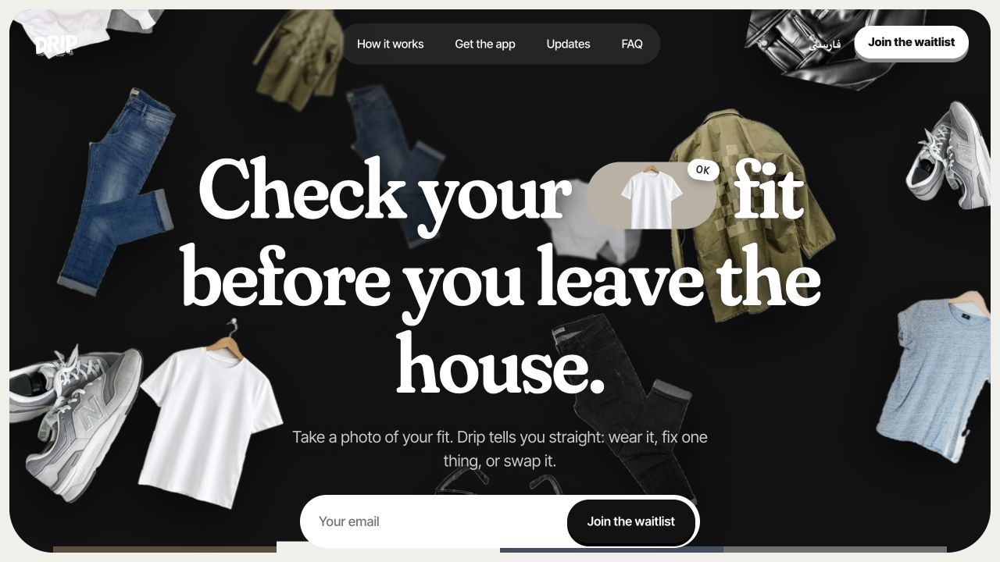
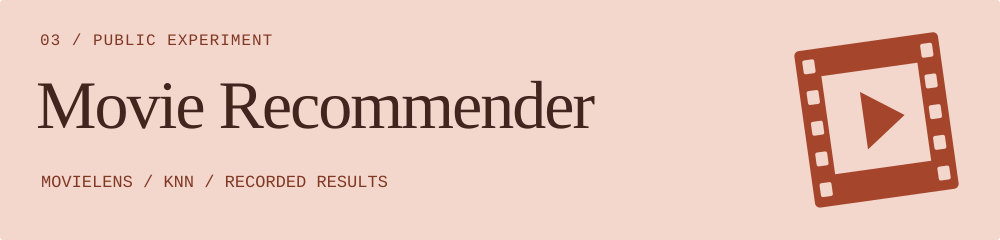

**Founder / Full-Stack Developer · Istanbul, Türkiye**

I turn questionable ideas into surprisingly functional software. Products, interfaces, applied ML—and the occasional poster.

[Portfolio](https://arian-portfolio-puce.vercel.app/) &nbsp; / &nbsp; [LinkedIn](https://www.linkedin.com/in/arian-shamsabadi-00508a281/) &nbsp; / &nbsp; [Real Company](https://realcompanys.com/)

## 01 / Drip

An outfit check, a second opinion before buying, and a memory for the clothes you own.

**Website live · iPhone app in private beta.** The public site has the product story and waitlist. The app is not publicly available in the App Store; its implementation is private.

[Explore Drip ↗](https://dressrightinpublic.com/)

## Public experiments

**[KnightVision](https://github.com/TheRealShamsaba/KnightVision)** — a custom rules engine, policy/value networks, and self-play experiments. Built with [BakerDmo](https://github.com/BakerDmo).

[Rules tests & setup](https://github.com/TheRealShamsaba/KnightVision#quick-start-run-the-rules-tests) · [Model architecture](https://github.com/TheRealShamsaba/KnightVision/blob/main/ai/model.py)

**[Movie Recommender System](https://github.com/TheRealShamsaba/Movie-Recommender-system)** — genre similarity, collaborative filtering, and KNN evaluation on MovieLens.

[Recorded benchmark CSV](https://github.com/TheRealShamsaba/Movie-Recommender-system/blob/main/benchmark_summary.csv) · [Analysis & limitations](https://github.com/TheRealShamsaba/Movie-Recommender-system#repository-recorded-results)

## Beyond the repos

I build websites, apps, and internal tools through **[Real Company](https://realcompanys.com/)**. I also make [posters](https://arian-portfolio-puce.vercel.app/showcase) and host The Reasonable Show.

**Tools in the public work** 
React · TypeScript · Vite · Tailwind CSS · Python · PyTorch · pandas · scikit-learn

Design + engineering. A little humor with the stack traces.
